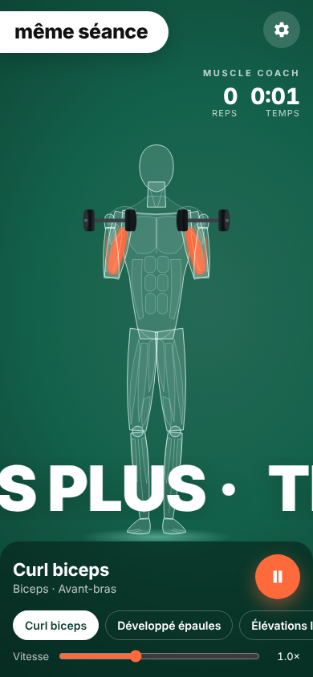

# Muscle Coach

Une app d'entraînement animée : un corps anatomique transparent sur fond vert fait l'exercice,
et les muscles travaillés s'allument en orange au rythme de chaque répétition.



## Ce qu'elle fait
- 5 exercices animés : curl biceps, développé épaules, élévations latérales, squat, extension triceps
- Muscle principal qui pulse à chaque contraction, muscles secondaires en surbrillance
- Bulle de texte qui change toute seule + grand texte qui défile en bas
- Compteur de répétitions, chrono, pause/lecture (barre espace), réglage de la vitesse
- ⚙️ **Personnalisable** : nom de l'app, phrases, texte défilant, couleur du fond et des muscles
  (sauvegardés sur le téléphone)
- Installable sur l'écran d'accueil (PWA), marche hors ligne

## Lancer
Pas besoin d'installation : ouvre `index.html`, ou sers le dossier :

```sh
python3 -m http.server 8000   # puis http://localhost:8000
```

Pour l'avoir sur ton téléphone, active **GitHub Pages** (Settings → Pages → branche) et
ouvre le lien, puis « Ajouter à l'écran d'accueil ».

## Ajouter un exercice
Dans `app.js`, ajoute un objet dans `EXERCISES` avec les muscles (`main`, `secondary`) et une
fonction `pose(t)` (t va de 0 = repos à 1 = contraction max) qui renvoie les angles
`abd` (bras écarté), `elbow`, `curl` et `knee`.
